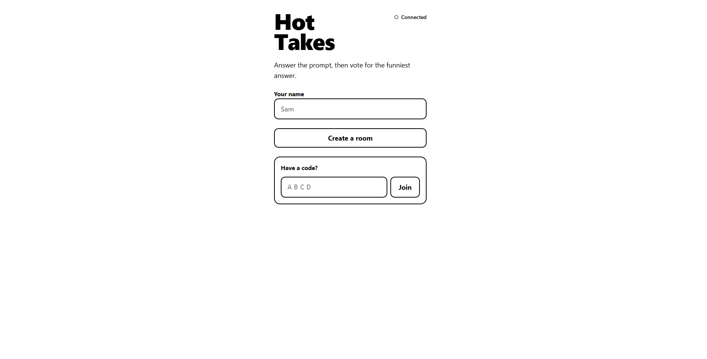

[](https://github.com/joeljosjoseph/Hot-takes/actions/workflows/cy.yml)
# Hot Takes
 
A real-time multiplayer party game for the browser. One person hosts a room, friends join from their phones with a 4-letter code, everyone answers a silly prompt, and the group votes anonymously on the best answer. Three rounds, one winner.

Live link: https://hot-takes-party-game.vercel.app/ 
( The server is deployed on render's free instance, therefore it might take around 30-50s to establish socket connection the first time you open the game, if the server was inactive for a while.
So please do be patient :) )
 

 
## How the game works
 
1. The host creates a room and shares the 4-letter code.
2. Players join from any device and appear live in the lobby.
3. Each round shows a prompt. Players have 30 seconds to answer. Anything typed but not submitted is auto-submitted when time runs out.
4. Everyone sees the answers in a shuffled order with no authors, and votes for their favourite (you can't vote for your own).
5. Authors are revealed, votes become points, and the scoreboard updates.
6. After three rounds, the final scoreboard crowns a winner and the host can start a new game.
## Features
 
- Room creation and joining with short, shareable codes
- Live lobby, with automatic host handover if the host leaves
- Server-controlled phase timers with a live countdown on every client
- Anonymous voting: authors are never sent to clients until results are revealed
- Per-player shuffled answer order, and server-side rejection of self-votes
- Early finish when everyone has answered or voted
- Auto-submit of unsent drafts at the deadline
- Scoring across multiple rounds, with a play-again flow
## Design notes
 
- **Server-authoritative.** Clients only send requests (`answer:submit`, `vote:submit`, ...). The server validates every payload, owns the game state, and decides when phases change.
- **Secrets stay on the server.** Answers, drafts and votes live in separate server-side maps instead of on the room object that is broadcast, so the room state can never leak who wrote what.
- **Deadlines, not durations.** The server sends a `phaseEndsAt` timestamp so every client computes the same countdown.
- **Stale timers are guarded.** Phase-ending functions look the room up fresh and check the current phase, so a leftover timer can't act on a finished or deleted room.
- **Refreshing the page leaves the game.** This is intentional for a casual party game, so players who disconnect are removed from the room.
## Tech stack
 
| Part | Tech |
|---|---|
| Client | Next.js, React, TypeScript, Tailwind CSS |
| Server | Node.js, Express, Socket.io, TypeScript |
 
## Run locally
 
Requires Node 20+.
 
```
# terminal 1: server (http://localhost:4000)
cd server
npm install
npx tsx watch index.ts
 
# terminal 2: web app (http://localhost:3000)
cd web
npm install
npm run dev
```
 
Open http://localhost:3000. To test with several players, use a normal window plus an incognito window, or a second browser.
 
## Project structure
 
```
server/
  index.ts      Socket handlers and game flow
  type.ts       Player, Room, Answer types
  timer.ts      Phase timers (start/stop by room code)
  prompts.ts    Prompt list and random picker
  roomCode.ts   Room code generator
web/
  app/          Next.js pages and the socket client
  lib/types.ts  Client-side types
```

## Deployment

The frontend is deployed on Vercel, while the backend server is hosted on Render. The Next.js application connects to the deployed Socket.io server to support real-time multiplayer gameplay across devices. Environment variables are configured separately for each deployment to ensure the client connects to the correct production server and CORS is restricted to the deployed frontend origin. The backend runs on Render's free tier, so it may spin down after periods of inactivity, resulting in an initial connection delay of approximately 30–50 seconds when starting a new session. Once the server is active, gameplay and real-time communication work normally.
 
## Roadmap
 
- [x] Rooms, lobby and host handover
- [x] Answering, voting and results phases with server timers
- [x] Scoring, multiple rounds and play again
- [ ] Reject joins while a game is in progress
- [x] Unit tests for game logic (Vitest)
- [x] End-to-end test of a full game (Playwright)
- [ ] Animations and mobile polish
- [x] CI with GitHub Actions
- [x] Deployment with a live demo link
## License
 
MIT
